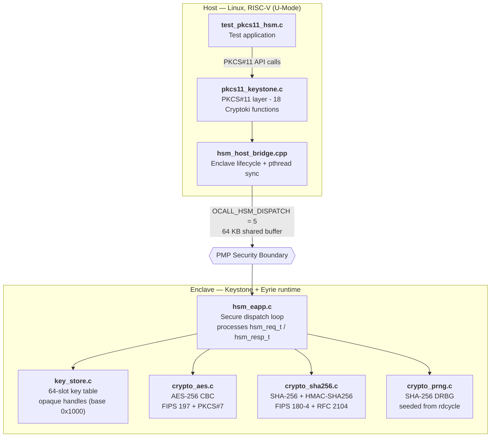

# HSM on RISC-V Keystone TEE

**BTP Project — IIT Kharagpur**
Aditya Goyal (23EC30067) · Dept. of Electronics & Electrical Communication Engineering
Supervisor: Prof. Sarani Bhattacharya

---

A freestanding **Hardware Security Module (HSM)** running inside a [Keystone TEE](https://keystone-enclave.org/) enclave on RISC-V. Cryptographic services are exposed through an 18-function **PKCS #11 (Cryptoki v2.40)** API. Keys never leave enclave memory — the host only ever sees opaque 32-bit handles.

**Verified on:** QEMU 5.0.0 · gem5 v21.1 (AtomicSimpleCPU, full-system simulation)
**Test result: 8/8 PASS**

---

## Architecture



---

## Repository Layout

```
hsm-keystone-riscv/
├── hsm/
│   ├── hsm_eapp.c            # Enclave app: secure command dispatch loop
│   ├── hsm_host_bridge.cpp   # Host bridge: enclave lifecycle, pthread sync, OCALL
│   ├── hsm_host.h/.cpp       # Host-side enclave manager
│   ├── pkcs11_keystone.c     # PKCS #11 API layer (18 Cryptoki functions)
│   ├── pkcs11.h              # Standard PKCS #11 function prototypes
│   ├── pkcs11_types.h        # PKCS #11 type and mechanism definitions
│   ├── test_pkcs11_hsm.c     # Test harness — 8 tests, pure PKCS #11 calls
│   ├── hsm_protocol.h        # Wire format: hsm_req_t / hsm_resp_t, command IDs
│   ├── crypto_aes.c/.h       # AES-256 (FIPS 197) + CBC + PKCS#7 padding
│   ├── crypto_sha256.c/.h    # SHA-256 (FIPS 180-4) + HMAC-SHA256 (RFC 2104)
│   ├── crypto_prng.c/.h      # Counter-based SHA-256 DRBG seeded from rdcycle
│   ├── key_store.c/.h        # 64-slot key table, opaque handles, zeroization
│   ├── keystone_syscalls.c/.h# RISC-V Keystone syscall wrappers
│   ├── start.S               # Enclave entry point (_start → main → EAPP_RETURN)
│   ├── app.lds               # Linker script (freestanding, -nostdlib, ~30 KB)
│   ├── CMakeLists.txt        # Build config — static link against Keystone SDK
│   └── run_hsm.py            # gem5 full-system simulation script
├── logs/
│   ├── qemu_output.log       # QEMU terminal output: 8/8 PASS run
│   ├── gem5_terminal.log     # gem5 simulation terminal output
│   ├── gem5_stats.txt        # gem5 performance counters and statistics
│   └── gem5_hsm.log          # gem5 simulation run log
├── MASTER_REFERENCE.md       # Complete build/run reference with all commands
└── CRYPTO_OPERATIONS.md      # Detailed cryptographic algorithm documentation
```

---

## PKCS #11 API — Implemented Functions

The 18 Cryptoki v2.40 functions implemented in `pkcs11_keystone.c`:

| # | Function | Purpose |
|---|----------|---------|
| 1 | `C_Initialize` | Boot the Keystone enclave, load `hsm-eapp` and `eyrie-rt` |
| 2 | `C_Finalize` | Shut down the enclave, free resources |
| 3 | `C_GetInfo` | Returns Cryptoki version (2.40), manufacturer, library description |
| 4 | `C_GetSlotList` | Returns available token slots |
| 5 | `C_GetSlotInfo` | Returns slot metadata |
| 6 | `C_GetTokenInfo` | Returns token metadata |
| 7 | `C_OpenSession` | Open a session (up to 16 concurrent sessions) |
| 8 | `C_CloseSession` | Close a session and clear its state |
| 9 | `C_GenerateKey` | Generate AES-256 or HMAC key inside the enclave |
| 10 | `C_EncryptInit` | Initialize AES-256 CBC encryption with IV |
| 11 | `C_Encrypt` | Encrypt data under enclave isolation |
| 12 | `C_DecryptInit` | Initialize AES-256 CBC decryption with IV |
| 13 | `C_Decrypt` | Decrypt data, strip PKCS#7 padding |
| 14 | `C_DigestInit` | Initialize SHA-256 digest |
| 15 | `C_Digest` | Compute SHA-256 hash inside the enclave |
| 16 | `C_SignInit` | Initialize HMAC-SHA256 signing |
| 17 | `C_Sign` | Sign a message, return 32-byte HMAC |
| 18 | `C_VerifyInit` / `C_Verify` | Verify HMAC; returns `CKR_SIGNATURE_INVALID` on tamper |
| 19 | `C_DestroyObject` | Zeroize key slot and invalidate handle |

> `C_Initialize` looks for `hsm-eapp` and `eyrie-rt` via env vars `KEYSTONE_HSM_EAPP` / `KEYSTONE_HSM_RUNTIME`, falling back to current directory.

---

## Build Requirements

| Requirement | Version | Notes |
|-------------|---------|-------|
| Keystone SDK | latest | Clone from [keystone-enclave/keystone](https://github.com/keystone-enclave/keystone) |
| RISC-V cross-toolchain | riscv64-unknown-linux-gnu | Included in Keystone buildroot |
| CMake | ≥ 3.10 | |
| debugfs | any | For rootfs injection |
| QEMU | 5.0.0 | For functional testing |
| gem5 | v21.1 | For cycle-accurate simulation |

The enclave binary is **freestanding** (`-nostdlib -static -T app.lds`): no glibc, no `/dev/urandom`, no dynamic linking.

---

## Server Paths (IIT KGP Lab Server: `10.5.31.131`)

```
/data/users/aditya/keystone/                         # Keystone SDK root
/data/users/aditya/keystone/sdk/examples/hsm/        # HSM source (this repo)
/data/users/aditya/keystone/build/examples/hsm/      # Compiled binaries
/data/users/aditya/keystone/build/buildroot.build/images/rootfs.ext2  # Rootfs image
/data/users/aditya/keystone/qemu/riscv64-softmmu/qemu-system-riscv64  # QEMU binary
/data/users/aditya/Keystone-experiments/gem5/        # gem5 binary
/data/users/aditya/Keystone-experiments/configs-keystone-default/      # gem5 configs
~/run_qemu.sh                                        # QEMU launch script
~/run_gem5_sim.sh                                    # gem5 launch script
```

---

## Build & Run

### Step 1 — Set up the Keystone environment

```bash
cd /data/users/aditya/keystone
source source.sh
```

This sets up `RISCV`, `PATH`, and Keystone SDK variables.

### Step 2 — Copy HSM source (if not already there)

```bash
cp -r hsm/ /data/users/aditya/keystone/sdk/examples/hsm/
```

### Step 3 — Build

```bash
cd /data/users/aditya/keystone/build
make examples
```

This produces three binaries in `build/examples/hsm/`:

| Binary | Description |
|--------|-------------|
| `hsm-eapp` | Enclave application (~30 KB, freestanding) |
| `test_pkcs11_hsm` | Host-side test runner |
| `eyrie-rt` | Eyrie enclave runtime |

### Step 4 — Inject into rootfs

```bash
ROOTFS=/data/users/aditya/keystone/build/buildroot.build/images/rootfs.ext2
BUILD=/data/users/aditya/keystone/build/examples/hsm

debugfs -w $ROOTFS <<EOF
rm /root/hsm-eapp
write $BUILD/hsm-eapp /root/hsm-eapp
set_inode_field /root/hsm-eapp mode 0100755
rm /root/test_pkcs11_hsm
write $BUILD/test_pkcs11_hsm /root/test_pkcs11_hsm
set_inode_field /root/test_pkcs11_hsm mode 0100755
rm /root/eyrie-rt
write $BUILD/eyrie-rt /root/eyrie-rt
set_inode_field /root/eyrie-rt mode 0100755
EOF
```

### Step 5 — Run on QEMU

```bash
~/run_qemu.sh
```

Inside the QEMU guest (login: `root`):

```bash
./test_pkcs11_hsm ./hsm-eapp ./eyrie-rt
```

Expected output:

```
============================================================
   KEYSTONE RISC-V HARDWARE SECURITY MODULE (HSM) SUITE
   PKCS #11 Verification running on Keystone Enclave / gem5
============================================================

[PASS] Keystone Enclave booted and ready!
    Cryptoki Version: 2.40
    ...
TEST SUITE SUMMARY: 8/8 TESTS PASSED (100%)
============================================================
```

### Step 6 — Run on gem5 (cycle-accurate simulation)

```bash
~/run_gem5_sim.sh
```

> Uses `AtomicSimpleCPU`. Do not use `O3CPU` — it takes 12–24 hours just to boot Linux on this setup.

Simulation logs are written to `logs/gem5_stats.txt` and `logs/gem5_terminal.log`.

---

## Test Suite — 8/8 PASS

### Test 1: AES-256 Key Generation

Generates a 256-bit AES key inside the enclave using `C_GenerateKey`. The raw key material never leaves the PMP boundary — only an opaque handle is returned to the host.

```c
CK_MECHANISM keyGenMech = { CKM_AES_KEY_GEN, NULL, 0 };
CK_ULONG keyLenBytes = 32;
CK_ATTRIBUTE keyTemplate[] = {
    { CKA_VALUE_LEN, &keyLenBytes, sizeof(keyLenBytes) },
    { CKA_ENCRYPT,   (CK_BBOOL[]){CK_TRUE}, sizeof(CK_BBOOL) },
    { CKA_DECRYPT,   (CK_BBOOL[]){CK_TRUE}, sizeof(CK_BBOOL) }
};
CK_OBJECT_HANDLE hKeyAes = 0;
rv = C_GenerateKey(hSession, &keyGenMech, keyTemplate, 3, &hKeyAes);
// hKeyAes is an opaque handle — raw key bytes stay inside enclave
```

---

### Test 2: AES-256 CBC Encryption

Encrypts the string `"IIT-Kgp Keystone Enclave HSM Protected Top Secret!"` using AES-256 CBC with PKCS#7 padding. The IV is a 16-byte value passed via the mechanism parameter.

```c
uint8_t iv[16] = {0x00, 0x11, 0x22, 0x33, 0x44, 0x55, 0x66, 0x77,
                  0x88, 0x99, 0xaa, 0xbb, 0xcc, 0xdd, 0xee, 0xff};
CK_MECHANISM encMech = { CKM_AES_CBC_PAD, iv, sizeof(iv) };

rv = C_EncryptInit(hSession, &encMech, hKeyAes);
rv = C_Encrypt(hSession, plaintext, plaintext_len, ciphertext, &ciphertext_len);
```

---

### Test 3: AES-256 CBC Decryption (Round-trip)

Decrypts the ciphertext from Test 2 and verifies byte-for-byte match with the original plaintext using `memcmp`.

```c
rv = C_DecryptInit(hSession, &encMech, hKeyAes);
rv = C_Decrypt(hSession, ciphertext, ciphertext_len, decrypted, &decrypted_len);
// Verifies: decrypted_len == plaintext_len && memcmp(decrypted, plaintext) == 0
```

---

### Test 4: SHA-256 Hash

Hashes the string `"Keystone-gem5-HSM"` and verifies that a 32-byte digest is produced inside the enclave.

```c
CK_MECHANISM digestMech = { CKM_SHA256, NULL, 0 };
rv = C_DigestInit(hSession, &digestMech);
rv = C_Digest(hSession, (CK_BYTE_PTR)"Keystone-gem5-HSM", 17, digest, &digest_len);
// digest_len == 32
```

---

### Test 5: HMAC-SHA256 Sign

Generates a dedicated HMAC key and signs the message `"Authenticate this critical financial transaction!"`. Returns a 32-byte HMAC signature.

```c
CK_MECHANISM hmacGenMech = { CKM_SHA256_HMAC_KEY_GEN, NULL, 0 };
C_GenerateKey(hSession, &hmacGenMech, NULL, 0, &hKeyHmac);

CK_MECHANISM hmacMech = { CKM_SHA256_HMAC, NULL, 0 };
C_SignInit(hSession, &hmacMech, hKeyHmac);
C_Sign(hSession, message, msg_len, hmac_sig, &hmac_sig_len);
```

---

### Test 6: HMAC Verify + Tamper Detection

First verifies the valid HMAC from Test 5 (`CKR_OK`). Then flips one byte of the message (`tampered_msg[0] ^= 0xFF`) and verifies that the enclave correctly returns `CKR_SIGNATURE_INVALID`.

```c
// Valid message: should return CKR_OK
C_VerifyInit(hSession, &hmacMech, hKeyHmac);
rv = C_Verify(hSession, original_msg, len, hmac_sig, 32);  // -> CKR_OK

// Tampered message: flip 1 byte
tampered_msg[0] ^= 0xFF;
C_VerifyInit(hSession, &hmacMech, hKeyHmac);
rv = C_Verify(hSession, tampered_msg, len, hmac_sig, 32);  // -> CKR_SIGNATURE_INVALID
```

---

### Test 7: Security Boundary — Forged Handle Rejection

Attempts to use a fabricated handle (`0xDEADBEEF`) for encryption. The enclave key store must reject it with `CKR_OBJECT_HANDLE_INVALID`.

```c
CK_OBJECT_HANDLE forged_handle = 0xDEADBEEF;
C_EncryptInit(hSession, &encMech, forged_handle);
rv = C_Encrypt(hSession, plaintext, len, ciphertext, &ct_len);
// Expected: rv == CKR_OBJECT_HANDLE_INVALID
```

---

### Test 8: Key Destruction + Post-Destroy Access Denied

Destroys the AES key with `C_DestroyObject` (which zeroizes the key slot), then attempts to use the same handle again. The enclave must deny access.

```c
rv = C_DestroyObject(hSession, hKeyAes);  // Zeroizes the key slot
// Attempt to reuse the destroyed handle:
C_EncryptInit(hSession, &encMech, hKeyAes);
rv = C_Encrypt(hSession, plaintext, len, ciphertext, &ct_len);
// Expected: rv == CKR_OBJECT_HANDLE_INVALID
```

---

## Cryptographic Operations Summary

| Operation | PKCS#11 Mechanism | Standard | Key Size |
|-----------|-------------------|----------|----------|
| AES key generation | `CKM_AES_KEY_GEN` | PKCS #11 | 256 bit |
| AES-256 CBC encrypt | `CKM_AES_CBC_PAD` | FIPS 197 + PKCS#7 | 256 bit |
| AES-256 CBC decrypt | `CKM_AES_CBC_PAD` | FIPS 197 + PKCS#7 | 256 bit |
| SHA-256 digest | `CKM_SHA256` | FIPS 180-4 | — |
| HMAC-SHA256 sign | `CKM_SHA256_HMAC` | RFC 2104 | 256 bit |
| HMAC-SHA256 verify | `CKM_SHA256_HMAC` | RFC 2104 | 256 bit |
| Key destruction | `C_DestroyObject` | PKCS #11 | — |

---

## Key Design Notes

**Freestanding enclave**
No glibc, no `/dev/urandom`, no dynamic linking. Custom linker script (`app.lds`) and entry point (`start.S`). The binary is ~30 KB.

**PRNG**
Seeds from the RISC-V `rdcycle` hardware counter and runs a counter-based SHA-256 DRBG — the only viable approach inside a Keystone enclave.

**Opaque key handles**
Key material never crosses the PMP boundary. The host gets a 32-bit handle (base `0x1000`). The key store validates handles on every operation and zeroes the slot on `C_DestroyObject`.

**Static linking**
Keystone host libraries lack `-fPIC`, so the host binary is statically linked against the SDK.

**Single edge call**
All operations go through one edge call (`OCALL_HSM_DISPATCH = 5`) over a 64 KB shared buffer, keeping the trusted/untrusted interface minimal.
